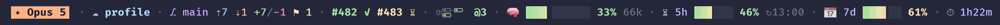
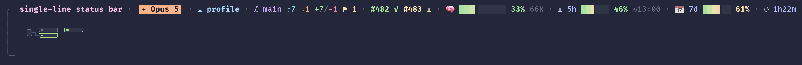
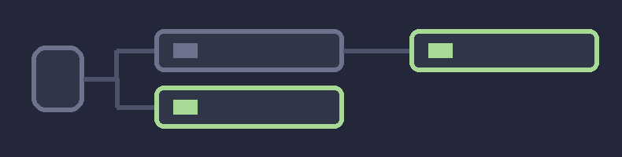

# claudecode-statusbar

A single-line status line for Claude Code, with a map of the active sub-agents drawn as an image, inside the line itself.


## Install

```
curl -fsSL https://raw.githubusercontent.com/danielfnfaria/claudecode-statusbar/main/install.sh | sh
```

Uninstall: `... | sh -s -- --uninstall`

The installer checks its dependencies, validates both scripts before replacing anything, keeps a timestamped backup of every file it touches, and leaves an existing `statusLine` command alone when it already points at the script.

## What it shows



One line, in this order:

| item | what it is |
| --- | --- |
| `my-session` | the session name (`/rename`, `--name` or the automatic title); it opens the line |
| `✦ Opus 5` | the model, in a badge colored by family |
| `☁ profile` | the active cloud profile (gcloud), colored by prefix |
| `⎇ main ⇡7 ⇣1 +7/-1 ⚑ 1` | branch, commits to push and to pull, lines changed, stashes |
| `#482 ✓ #483 ⏳` | the PRs opened in this session that are still open: one link each, green as soon as every check passes |
| tree of boxes `@3` | the agent map: the session and its active sub-agents, nested, drawn inside the line; `@n` is how many sub-agents are alive |
| `🧠 33% 66k` | the context window in use |
| `⏳ 5h 46% ↻13:00` | the 5-hour limit and when it resets |
| `📅 7d 61%` | the 7-day limit |
| `⏱ 1h22m` | how long the session has been running |

Context and limits come as bars with a green → yellow → red gradient, filled to an eighth of a
character.

The line adapts to the terminal width: as it narrows, items are dropped from the least to the
most important — the stash goes first, the model and the context window are the last to go.

## Agent map

The tree of active sub-agents: the root is the session and each small box is one agent. With no active agent it takes up nothing. `AGENT_MAP` picks the mode:

| mode | what you get |
| --- | --- |
| `inline` (default) | the whole tree, with its nesting, drawn inside one row of the line, between the PRs and the context. Next to it, `@n` is how many sub-agents are alive |
| `on` | a larger panel below the line, with more vertical room |
| `off` | nothing: no python runs and no image is sent |





A green outline is an agent working right now; a gray one has stopped and is waiting for the agents it spawned. An agent is on the map while it has not finished and has written to the transcript in the last `AGENT_MAP_MAX_AGE` seconds (60 by default).

The inline map stacks at most 4 boxes; `@n` counts every live agent, including the ones that did not fit.

In both modes the drawing is an image. The Claude Code TUI strips escape sequences from the status line output, so the image is transmitted straight to the tty using the kitty graphics protocol, and the status line itself prints only Unicode placeholders, which are ordinary text. On a terminal without that support it falls back to text: one colored dot per agent inline, text cards in the panel.

Needs Ghostty, kitty or WezTerm, and Pillow, for the drawing in either mode. Without them the rest of the status line works exactly the same.

## Configuration

Copy `statusline.conf.example` to `~/.claude/statusline.conf`:

- `PROFILE_COLORS` — color of the cloud profile, by prefix
- `AGENT_MAP` — `inline` (default), `on` or `off`

Agent map variables, from the environment:

- `AGENT_MAP_BG` — background color of the image (both modes)
- `AGENT_MAP_MAX_AGE` — seconds without a write before an agent leaves the map (both modes)
- `AGENT_MAP_ROWS` — the panel's minimum height in rows (`on` only; inline is always one row)

## Dependencies

`bash`, `jq`. Optional: `python3` + Pillow and a Ghostty, kitty or WezTerm terminal (the agent map drawing, in both modes; text fallback otherwise), `git` (branch), `gh` (pull requests).
